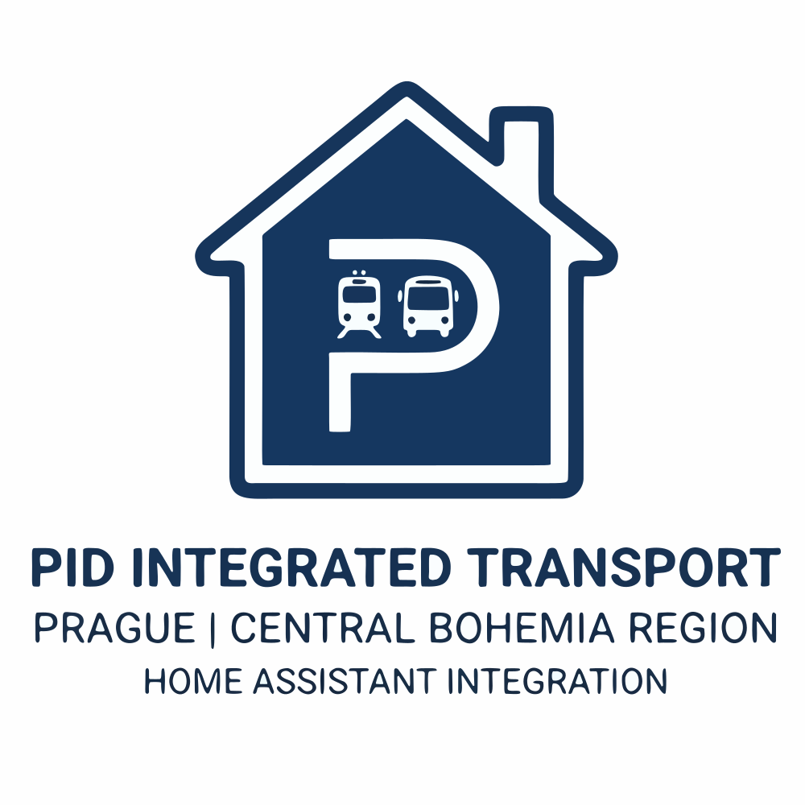
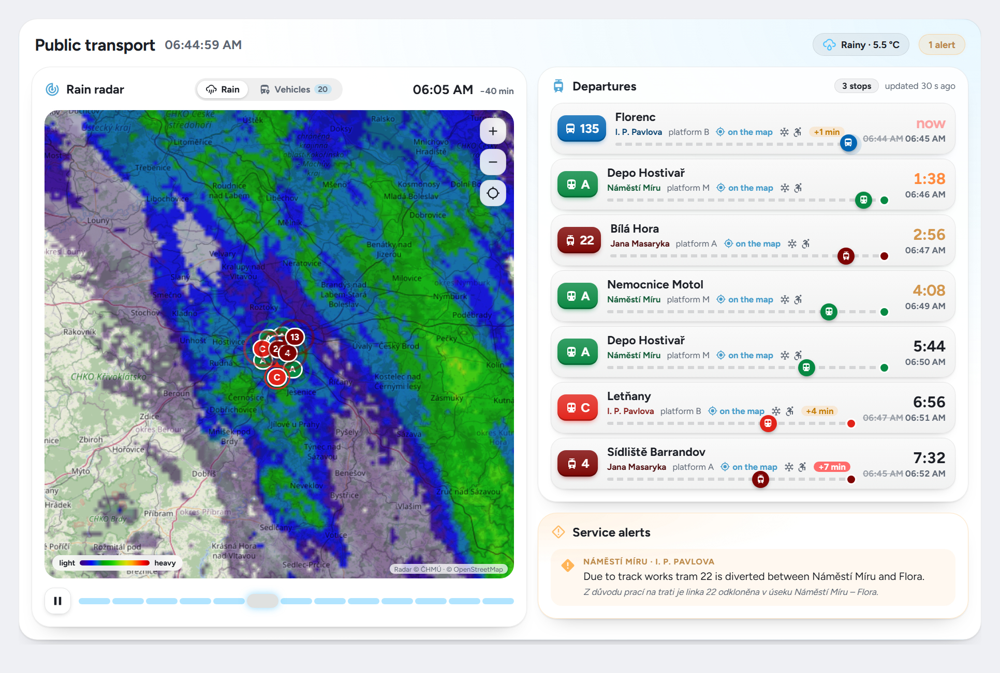
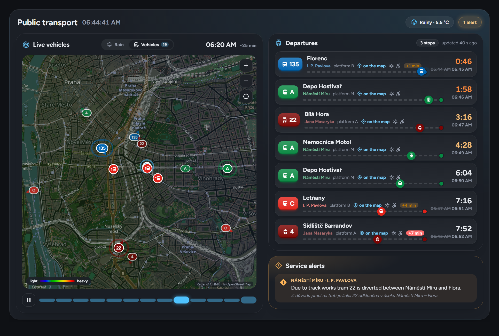
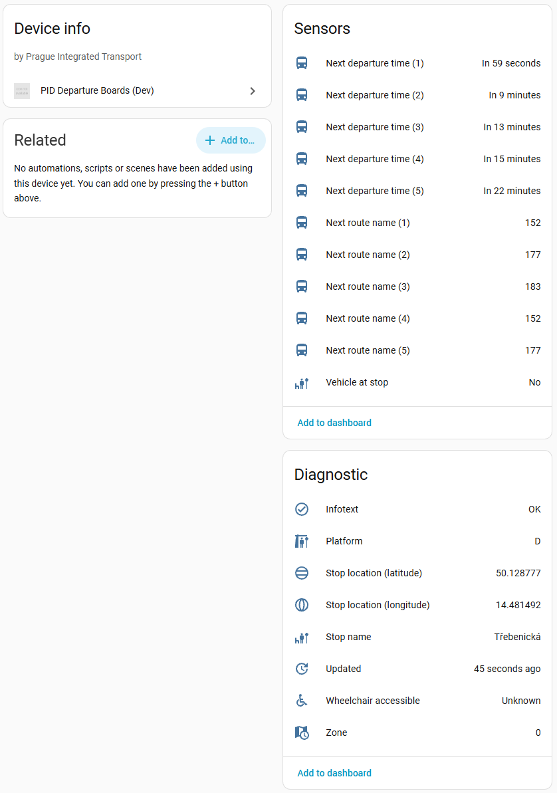

<p align="center"></p>

# PID Departure Board integration

This custom component provides a departures board information for the selected stops of the Prague Integrated Transport [PID](http://www.pid.cz/). 

Multiple departure boards can be configured.

## About this project

This is an independent fork of [dvejsada/PID_integration](https://github.com/dvejsada/PID_integration), started because the original project's development had stalled and several improvements were wanted. On top of the original's core departure-board functionality, this fork adds:

- Live GTFS-based stop search in the config flow (no more bundled, easily-outdated stop list)
- Extra Golemio API query options (mode, ordering, filtering, air-condition info, headsign enrichment)
- Live GPS tracking of the next incoming vehicle
- A Lovelace card bundled with the integration (no external card dependency): rain radar and live vehicles on a map, departures from one or several stops with live countdowns, and service alerts, optionally translated out of Czech via any Home Assistant conversation agent (e.g. Gemini)
- Modernized Home Assistant integration internals (`DataUpdateCoordinator`, options flow, reauth flow)

This repository has its own commit history, independent of the original project.



| Live vehicles view | Device page |
|:---:|:---:|
|  |  |

## Installation

### Using [HACS](https://hacs.xyz/)

<a href="https://my.home-assistant.io/redirect/hacs_repository/?owner=mesgas&repository=https%3A%2F%2Fgithub.com%2Fmesgas%2FPID-Prague-schedules&category=Integration" target="_blank" rel="noreferrer noopener"></a>

Add this repository to HACS as a custom repository (category: Integration), then install **PID Departure Boards (Dev)** from there.

### Manual

To install this integration manually you have to download the `pid_departures_dev` folder into your `config/custom_components` folder.

## Configuration

### Using UI

From the Home Assistant front page go to **Configuration** and then select **Integrations** from the list.

Use the "plus" button in the bottom right to add a new integration called **PID Departure boards**.

Setup is two steps:

1. Enter your API key (if you don't have one, get it here: https://api.golemio.cz/api-keys/auth/sign-up). It is only required once - for additional departure boards it is prefilled.
2. Pick a stop from the list (type to search - the list is fetched live from Golemio, not bundled in the integration, so it's always current), the number of departures to display, the number of calendar events to create, and optionally enable live tracking of the next vehicle's position.

The success dialog will appear or an error will be displayed in the popup.

### Changing options

The number of departures, number of calendar events, the walking-time offset, and vehicle tracking can be changed at any time via the **Configure** button on the integration entry — there is no need to delete and re-add the board. The same dialog also exposes advanced Golemio API query options (mode, ordering, filtering, skipping canceled/at-stop trips, air-condition info, headsign enrichment) for anyone who wants to fine-tune the raw departure query; the defaults match the previous behaviour.

If your Golemio API key stops working (e.g. it expired), Home Assistant will prompt you to re-authenticate; just enter a new key and the board reloads automatically.

### Live vehicle positions

With **Show live positions of all vehicles of these lines nearby** enabled (the default, under **Configure**), each board gets a *Live vehicles* sensor. Every 15 seconds it asks Golemio's `/v2/public/vehiclepositions` - in a single request - for every vehicle of the routes currently on the board within 3 km of the stop. The state is how many there are; the `vehicles` attribute lists them with `route`, `route_type`, `latitude`, `longitude`, `bearing`, `delay` (seconds), `state` (`on_track` / `at_stop`), `trip_id`, `vehicle_id`, `headsign` and `to_stop` (true for the trips on this board's departures). Metro trains are reported as the track segment they are on; the sensor gives its centre. The list is kept out of the recorder, so it does not grow the database. A failed poll keeps the last known positions instead of emptying the list.

The [dc-transit-card](https://github.com/mesgas) of the dashboard-cards suite draws these on a map, gliding between updates.

### Translating service announcements

Golemio's service announcements ("infotexts") are Czech-only. If you have a conversation agent configured in Home Assistant (e.g. Google Generative AI / Gemini, used for Assist), you can point the integration at it under **Configure → advanced options**: pick the agent and the language to translate into. Translated text is cached in memory (per unique announcement) so the agent isn't re-queried every 60-second refresh - only when an announcement actually changes.

### Deliberately not implemented

A few more Golemio PID endpoints exist (`/v3/pid/infotexts` city-wide, `/v3-v4/pid/transferboards`, `/v3/pid/departurepresets`). They were left out as low value for a per-stop departure board (city-wide, experimental/train-only, or ROPID-internal, respectively) - open an issue if you have a use case for one of them.

## Dashboard

The integration ships its own Lovelace card - **PID Transit Card** - and registers it by itself, with no external dependency. Add it from the card picker ("+ Add card" → search "PID Transit"), or with YAML:

```yaml
type: custom:pid-transit-card
device_ids:            # optional: leave out to show every departure board
  - <departure board's device id>
rows: 12
sort_by: time          # "time" merges all stops into one list; "stop" gives each its section
weather: weather.home  # optional, shown in the header
```

One card, for a panel view or a dashboard column, that adapts to its width (side by side on a wall tablet, stacked on a phone):

- **Rain radar.** ČHMÚ's open-data radar composite (Czech Hydrometeorological Institute: every 5 minutes, 1 km), the last hour animated over Home Assistant's own map, with a timeline, play/pause, zoom and recenter. `radar_source: rainviewer` switches to RainViewer for places outside Czechia (worldwide, but every 10 minutes and only up to zoom 7 on the free tier).
- **Live vehicles.** A *Rain | Vehicles* switch zooms the map on your stops and shows every vehicle of their lines nearby (from the *Live vehicles* sensor, see above) as a pill with the line number in PID colours and an arrow for its heading; those bound for your stops are highlighted. They glide between the 15-second updates. Tapping a tracked departure centres the map on that vehicle and follows it.
- **Departures.** Line badges in PID colours, headsign, stop and platform, second-by-second countdowns that change colour as the vehicle nears, a little road the vehicle travels in the last 20 minutes, delays with the scheduled time struck through, cancellations, air-conditioning, wheelchair and night-line icons.
- **Service alerts**, shown only when there are some, translated if a conversation agent is configured, each one once even when it applies to several stops.

The map uses Home Assistant's own tile proxy (`/api/map_tiles`), so there is no key to sign up for; on older Home Assistant versions without it the radar stays on a neutral background, and `map_url` can name another `{z}/{x}/{y}` tile server.

| Option | Default | |
|---|---|---|
| `title` | localized "Public transport" | header |
| `device_ids` | every board | the departure boards to show |
| `rows` | `12` | rows in total (per stop with `sort_by: stop`) |
| `sort_by` | `time` | `time` or `stop` |
| `max_minutes_ahead` | `0` | hide departures further away than this (0 = no limit) |
| `show_alerts` / `show_radar` | `true` | |
| `weather` | - | weather entity for the header |
| `radar_source` | `chmi` | `chmi` or `rainviewer` |
| `radar_product` | `maxz` | `maxz` (maximum reflectivity) or `cappi` (2 km) |
| `zoom` / `live_zoom` | `9` / `14` | map zoom for rain and for vehicles |
| `past_minutes` | `60` | minutes of radar to animate |
| `latitude`, `longitude` | home | map centre |
| `map_url` | Home Assistant's tiles | another tile server |

The card follows your Home Assistant language: English, Czech and Italian so far. Radar © ČHMÚ, map © OpenStreetMap contributors.

**Upgrading from 1.x:** `pid-departures-card` and `pid-alerts-card` are gone, replaced by this card; their Lovelace resource is removed automatically. Dashboards that used them show "custom element doesn't exist" until those cards are replaced with `custom:pid-transit-card` (`device_ids` and `sort_by` keep their meaning).
